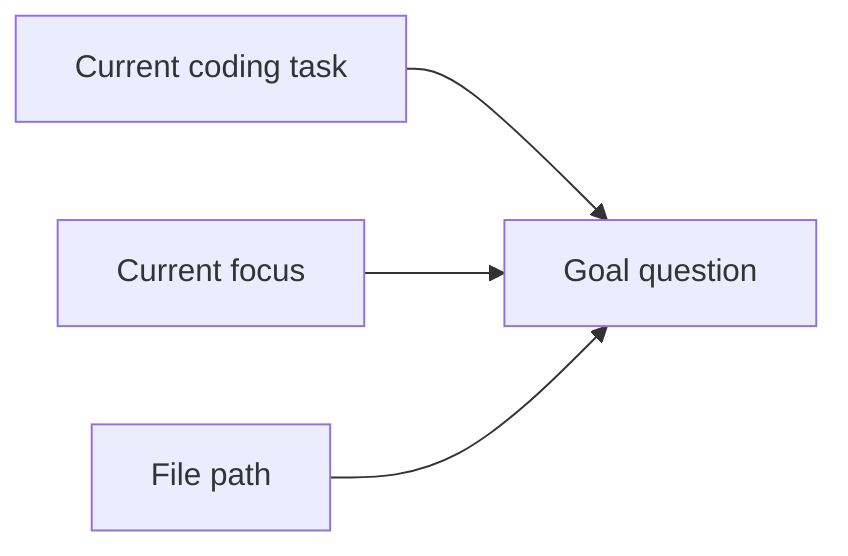
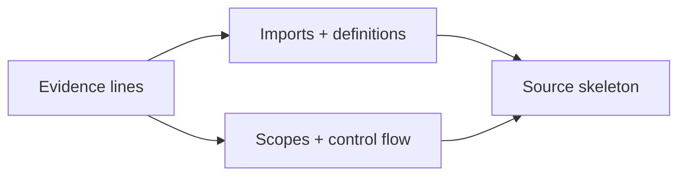
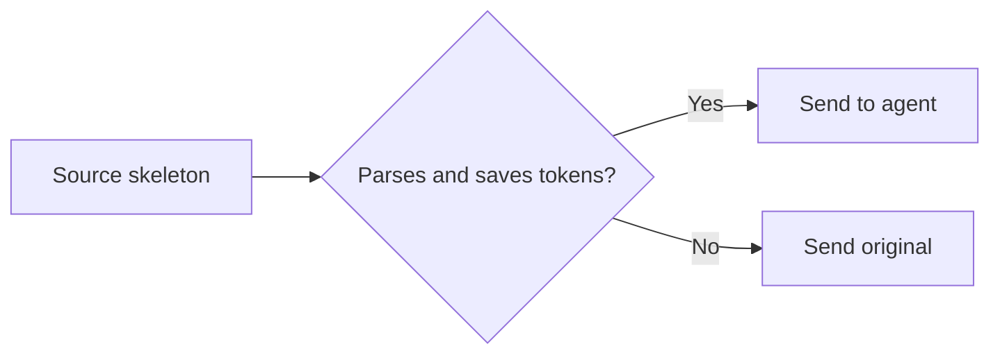

# JevSweep (ContextLens package)

ContextLens turns the current coding task into a goal question, asks the
released SWE-Pruner 0.6B model which source lines matter, then restores the
Python structure needed to use them. Every original is recoverable.

The package name and CLI remain `contextlens`. The scoring model is the
released `ayanami-kitasan/code-pruner` checkpoint (Jev); it scores relevance
only. The host coding agent chooses all tools and actions.

## Integrate at the tool boundary

Install the wrapper in the agent host's tool dispatcher, before the returned
text is appended to model context. The agent does not call a pruning tool.

```python
from pathlib import Path
from contextlens.pruning import ContextPruner, LocalSwePrunerScorer, PruningSession, ReceiptStore
from contextlens.pruning.middleware import ToolResultMiddleware

store = ReceiptStore(Path(".contextlens/receipts"))
session = PruningSession(ContextPruner(LocalSwePrunerScorer(), store),
                         "Fix the refresh-token timeout")
middleware = ToolResultMiddleware(session)

# Register this callable instead of the original read_file callable.
agent_tools["read_file"] = middleware.wrap(read_file, "read_file")
```

`wrap` accepts a synchronous, keyword-argument tool callable returning plain
text. Nontext results, writes, search results, unsupported languages, short
reads, errors, test output, and diffs pass through. The default gate only
calls Jev when a read has at least twice the minimum expected savings (512
estimated tokens), and only returns a pruning result when it saves that much.
The estimate uses UTF-8 bytes divided by four; provider token usage may differ.
Any middleware or scoring error sends the original result. Model latency and
cost are therefore incurred only for eligible reads; the gate is a heuristic,
not a measured break-even guarantee.

For long sessions, call `compact_transcript(messages, store)` from
`contextlens.pruning.transcript` before constructing a model request. It
replaces older ordinary tool messages with receipt markers, keeps recent
messages and state-changing or diagnostic output, and retains message order.
`recover_message(marker_message, store)` restores the complete original
message. The host must expose receipt recovery to its agent if the agent
needs to revisit omitted content.

## See it

```python
# input: client.py
from transport import BaseTransport
from metrics import record_request

class Client(BaseTransport):
    def refresh_token(self, retry):
        record_request("refresh")
        if retry.enabled:
            return self.post("/token", timeout=retry.timeout)
        return self.post("/token")

def unrelated_report():
    ...
```

```bash
contextlens prune \
  --task "Fix the refresh-token timeout" \
  --input client.py
```

```python
from transport import BaseTransport
# [ContextLens cl_0123456789abcdef01234567 omitted original lines 3-4]

class Client(BaseTransport):
    def refresh_token(self, retry):
        # [ContextLens cl_0123456789abcdef01234567 omitted original lines 7-7]
        if retry.enabled:
            return self.post("/token", timeout=retry.timeout)
        return self.post("/token")
# [ContextLens cl_0123456789abcdef01234567 omitted original lines 11-13]
```

The JSON result records the generated goal and why each line survived.

## Architecture

### 1. Create a goal for every read

Following [SWE-Pruner](https://arxiv.org/abs/2601.16746), ContextLens sits
between read tools and the agent.



### 2. Let the 0.6B skimmer choose evidence

Following [SWE-Pruner](https://arxiv.org/abs/2601.16746), the goal and source
are encoded together. Token scores are averaged by line and thresholded.


### 3. Restore structural support

[LaMR](https://arxiv.org/abs/2605.15315) shows why semantic evidence needs
dependency closure. ContextLens traces those dependencies with the Python AST.



### 4. Validate or fall back



Small, unsupported, invalid, and non-saving results pass through unchanged.
Today, pruning handles Python source; other observation types are classified
but bypassed.

## Install

Requires Python 3.12+. Installation includes the official SWE-Pruner runtime
and PyTorch.

```bash
python -m pip install -e ".[dev]"
```

The default model is `ayanami-kitasan/code-pruner`. The first prune downloads
its 1,345,835,359-byte checkpoint from Hugging Face. Local inference requires
CUDA by default. Pin a local copy with:

```bash
hf download ayanami-kitasan/code-pruner --local-dir .contextlens/models/pruner
contextlens prune --model .contextlens/models/pruner \
  --task "Fix the refresh-token timeout" --input client.py
```

An existing SWE-Pruner server remains supported:

```bash
contextlens prune --backend http \
  --backend-url http://127.0.0.1:8000/prune \
  --task "Fix the refresh-token timeout" --input client.py
```

CPU inference is available only as an explicit `--allow-cpu` opt-in because
the upstream runtime pads inference to 8,192 tokens.

Narrow the query as the agent's focus changes:

```bash
contextlens prune \
  --task "Fix the refresh-token timeout" \
  --focus "Trace retry options passed to the request" \
  --tool read_file \
  --argument path=client.py \
  --input client.py \
  --json
```

JSON includes line-level reasons, omitted ranges, token reduction, backend,
latency, and receipt ID.

## Recover

```bash
# complete observation
contextlens recover cl_0123456789abcdef01234567

# selected original lines
contextlens recover cl_0123456789abcdef01234567 \
  --start-line 80 --end-line 130
```

Receipts live in `.contextlens/receipts` by default. Files are read and written
without newline translation, so recovery preserves CRLF and long lines exactly.

## Serve

```bash
contextlens serve --host 127.0.0.1 --port 8765
```

```text
GET  /health
POST /v1/prune
POST /v1/recover
```

The server binds to loopback by default and caps request bodies at 16 MiB.

## Benchmark

`contextlens.pruning.comparison.compare_strategies(tasks, run)` invokes the
same task list with `baseline`, `rules`, and `jev` strategies and reports
per-task success, provider input-token difference from baseline, and whatever
measured cost and latency the runner returns. The supplied runner must use a
fresh, equivalent coding-agent environment for each invocation and implement
the baseline and simple rule strategy. This comparison contract is tested;
no three-way coding-task success or cost results are claimed here.

Run the same model once across three realistic repository reads:

```bash
python benchmarks/pruning_runtime.py
```

The harness measures per-case wall time and token reduction, parses every
result, and verifies byte-exact receipt recovery. It reports JSON and keeps the
model warm between cases.

### CPU smoke test

Observed September 3, 2026 on Windows 11, Python 3.14.5, PyTorch 2.14,
Intel i7-13700H, 15.6 GB RAM, and no CUDA:

| Check | Result |
| --- | --- |
| Clean editable install | Pass |
| Checkpoint download with `hf-xet` | Pass |
| Cached checkpoint size | 1,345,835,359 bytes |
| First real repository read | Stopped after 8 minutes |
| Memory observed during inference | 6.0 GB resident; 14.8 GB private |

No token-reduction number is claimed for that incomplete run. Use a CUDA host
or `--backend http` for real agent traffic. To reproduce the CPU result
despite the warning, pass `--allow-cpu`.

## Develop

```bash
python -m pytest -q
ruff check src tests
mypy
```

Method references: [SWE-Pruner](https://arxiv.org/abs/2601.16746) and
[LaMR](https://arxiv.org/abs/2605.15315). ContextLens loads the released
SWE-Pruner checkpoint; LaMR-style dependency support is deterministic until a
compatible multi-rubric checkpoint is released.

Released under the [MIT License](LICENSE).
