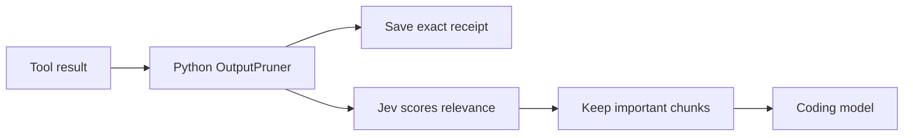

<h1 align="center">JevSweep</h1>

<p align="center">Jev-powered context optimization for AI coding agents. Reduces token usage by filtering irrelevant tool output before inference.</p>

## How it works

1. **Capture.** A Claude Code hook or explicitly invoked Codex wrapper captures a tool result before the coding model reads it.
2. **Protect.** JevSweep saves the exact original locally, then keeps errors, test failures, exit status, important results, and uncertain chunks.
3. **Score.** Large eligible output is split into chunks. Jev scores their relevance to the current coding task; small and unsuitable output skips Jev.
4. **Deliver.** Low-value chunks become receipt markers. `contextlens recover RECEIPT_ID` restores the original. If Jev fails, the original passes through.

## System design



Claude Code uses a `PostToolUse` hook for successful Bash stdout. Codex uses the same engine through `jevsweep-run`; **direct Codex commands are not intercepted**. Jev does not write code or choose the agent's next action.

## Results

The [September 2026 benchmark](benchmarks/results/four-condition-2026-09-21-tuned.md) reported 36.2% fewer injected tool-output tokens and 24.8% fewer uncached coding-model input tokens, with 5/10 verified fixes in both baseline and JevSweep. **That run used an earlier implementation; these results have not been reproduced for this version.** The paired benchmark measures estimated tool-output tokens separately from provider-reported coding-model usage, Jev usage, verified fixes, and latency.

## Run it

Install JevSweep and provide Jev gateway access:

```bash
python -m pip install -e .
export AI_GATEWAY_API_KEY="..."
```

Claude Code:

```bash
jevsweep-install claude --path /path/to/project
export JEVSWEEP_TASK="fix the failing parser test"
cd /path/to/project && claude
```

Codex (invoke `$jevsweep` or wrap a verbose command explicitly):

```bash
jevsweep-install codex --path /path/to/project
jevsweep-run --task "fix the failing parser test" -- rg parser src tests
```

On PowerShell, set the task with `$env:JEVSWEEP_TASK = "fix the failing parser test"`. Receipts default to `.contextlens/receipts`.

The ten-issue paired benchmark runs a separate coding agent and requires `OPENAI_API_KEY` as well as `AI_GATEWAY_API_KEY`; normal Claude Code and Codex use do not require an OpenAI API key:

```bash
python -m benchmarks.run --output benchmarks/artifacts/new-run --trials 1 --timeout 300
```
